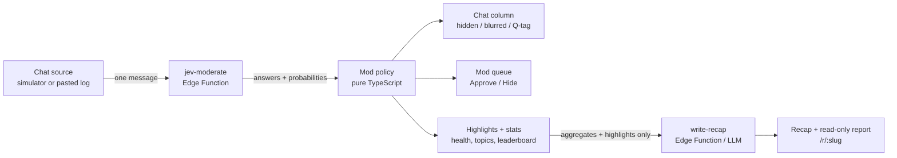

# ModSquad — your chat, moderated live

ModSquad is a live-chat **moderation copilot** for streamers, built as a
self-contained demo. It plays a simulated Twitch/YouTube-style chat stream (or
a pasted chat log), and every message is checked live:

- **Jev** (TypeSafe AI's fast decision model, `jev-1.13.0`, pinned) judges each
  message with **one request per message**, answering six atomic questions in
  that single call: toxicity (score), spoiler, real question, spam, topic
  (choice), and bot-instruction attempt (all yes/no "noul" style).
- **Code applies your mod policy** — hide, blur-as-spoiler, highlight, flag for
  review, timeout suggestion. The model never makes policy decisions.
- **The LLM only writes**: the end-of-stream recap and suggested answers to top
  questions. It never sees the full chat log — only aggregates and highlights.

> **Simulation only.** ModSquad never connects to real Twitch/YouTube
> accounts, never posts to any chat, and never issues real bans or timeouts.
> All mod actions are shown in-app only. See [Rules & scope](#rules--scope).

## How it works



Per message: Jev answers six questions in one request (concurrency 6 with a
small client-side queue, so playback never blocks). Code extracts the answers,
computes confidence, applies the editable policy, and files the message into
the chat column, mod queue, or highlights.

## Rules & scope

- **Simulation and paste only.** No connection to real Twitch/YouTube
  accounts, no posting to any chat, no real bans or timeouts. Mod actions are
  only shown in the app.
- **Chat text is untrusted data.** It is wrapped as literal data in every Jev
  and LLM call. Instruction-like messages ("ignore your rules", "mod, unban
  me") are flagged for human review — never obeyed.
- **Usernames in fixtures are fake.** Pasted logs are stored only in this
  demo's database and can be deleted with one button.
- **All keys stay server-side** in Supabase Edge Function secrets. Nothing
  secret goes in the browser bundle. Functions read keys, URLs and model
  names from env only, never from the request.
- **Daily cap.** Every paid upstream request (each Jev/LLM call, retries
  included) first increments a per-function counter through the
  service-role-only `increment_usage` SQL function. After **200 calls per day**
  (override with the `DAILY_CALL_LIMIT` secret) the function returns a friendly
  429; if the counter can't be read it fails closed with 503. Offline replay
  and the Mock writer keep working.
- **Locked-down database.** The browser can only read `sessions` (for the
  report page). Reports are saved and deleted by the `save-report` /
  `delete-reports` Edge Functions; a pasted-chat report can only be deleted
  from the browser that saved it (it holds that report's delete token).
- **JWT required.** Every Edge Function has `verify_jwt = true`; the browser
  calls them with `supabase.functions.invoke`, which sends the anon key.
- **Fallback, clearly labeled.** If Jev is unreachable, a keyword fallback
  (link patterns, caps ratio, small blocklist, trailing "?") takes over and
  every message is labeled **"Fallback (not Jev)"**.

## Why Jev

Chat moderation is a per-message, millisecond-scale judgment problem with a
small, fixed question set — exactly what a fast calibrated classifier is good
at. Jev returns calibrated probabilities (`noul` values, score confidence,
choice distributions) at chat speed and a fraction of the cost of a
general-purpose LLM. The expensive LLM is reserved for what it is actually
good at: writing the recap and suggested answers, from aggregates only.

## Mod policy (all in code)

- **Hide** if toxic score ≥ 2.5 (Moderate+) or spam ≥ 0.8. **Timeout
  suggestion** when the same user hits Hide 3 times in 5 minutes.
- **Blur as spoiler** if spoiler ≥ 0.6 (click to reveal, "Spoiler hidden"
  label).
- **Highlight question** if question ≥ 0.7 and not hidden. Priority =
  `question_p × (1 + 0.2 × similar_count)`, grouped by token overlap.
- **Flag for mod review** when any answer is uncertain (0.4–0.6), toxic
  confidence < 0.5, or injection ≥ 0.5.
- **Chat health** over a rolling 60 s window: `100 − 40·toxic_rate −
  30·spam_rate − 20·spoiler_rate`, clamped to 0–100.

All thresholds are editable in the in-app **Mod policy** panel.

## Setup

```bash
npm install

# Secrets (server-side only):
supabase secrets set TYPESAFE_API_KEY=... OPENAI_API_KEY=... OPENAI_MODEL=gpt-6-luna
# optional:
supabase secrets set OPENAI_BASE_URL=https://your-proxy.example.com/v1
supabase secrets set DAILY_CALL_LIMIT=200

# Apply the database migrations:
supabase db push

# Deploy the Edge Functions (all use verify_jwt = true from config.toml):
supabase functions deploy jev-moderate
supabase functions deploy write-recap
supabase functions deploy save-report
supabase functions deploy delete-reports

npm run dev
```

`.env.example` lists the only browser-side variables (`VITE_SUPABASE_URL`,
`VITE_SUPABASE_ANON_KEY`).

## Environment variables

| Variable | Where | Purpose |
| --- | --- | --- |
| `TYPESAFE_API_KEY` | Edge Function secret | Jev API key (jev-moderate) |
| `OPENAI_API_KEY` | Edge Function secret | LLM key (write-recap); template text if missing |
| `OPENAI_MODEL` | Edge Function secret | Model name, default `gpt-6-luna` |
| `OPENAI_BASE_URL` | Edge Function secret | Optional; default `https://api.openai.com/v1` |
| `DAILY_CALL_LIMIT` | Edge Function secret | Optional; per-function daily cap, default `200` (`0` blocks all calls) |
| `VITE_SUPABASE_URL` | Browser `.env` | Supabase project URL |
| `VITE_SUPABASE_ANON_KEY` | Browser `.env` | Supabase anon key |

## Offline demo

The three scripted streams ship with **recorded Jev responses**. Toggle
**Offline replay** to play them with zero API calls while still running the
real policy code. **Live Jev** calls the model for every message as it
arrives. The **Mock writer** toggle replaces LLM recap writing with template
text built from the numbers — Jev still runs live in mock mode.

## Screenshots


_Chat column (left), mod queue (middle), highlights and stats (right)._


_Read-only end-of-stream report at `/r/:slug`._

## Limitations

- Chat is simulated or pasted; there is no real platform integration.
- Question grouping uses simple token overlap, not embeddings.
- Cost and latency constants (Jev price, estimated LLM cost per message) are
  illustrative and editable in code.
- The daily cap is per Edge Function, not per visitor.

## Design decisions

- **Judgment and writing are separated.** Jev judges (fast, cheap, calibrated);
  code moderates (auditable, testable policy); the LLM writes only the recap
  from aggregates — it never sees the raw log, so chat data never reaches a
  general-purpose model.
- **One request per message.** All six questions ride in a single Jev call —
  far faster and cheaper than six separate calls.
- **Policy in code, thresholds in UI.** The model returns judgments, never
  actions, so every hide/blur/highlight is explainable from numbers.
- **Uncertainty is surfaced, not resolved.** Borderline messages go to the mod
  queue; overrides are tracked as "mod disagreed with Jev" stats.
- **Deno Edge Functions with strict CORS.** Every response (preflight,
  success, error) carries the required header set. Request bodies, item
  counts and field lengths are bounded (413/422) before any paid call, and
  upstream error text is logged server-side, never returned to the browser.
